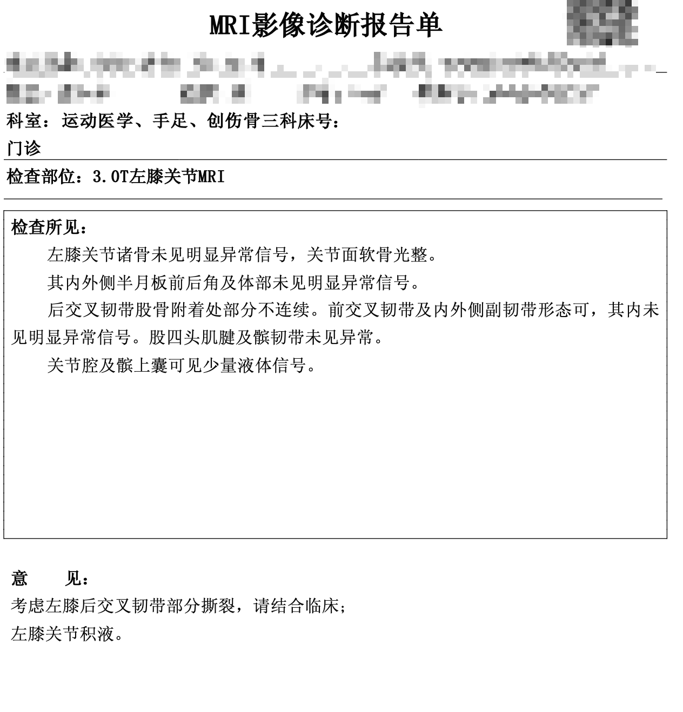

2025 年 1 月我开始跑步，马上就要两年了。最近注意到，自己跑步的心态发生了不小的转变。

最明显的变化是从刚开始为了跑步而跑步，变成了现在享受跑步的状态。刚开始跑步的时候，我就认定这是要做一辈子的事情 —— 这点我自始至终没有发生变化。

但刚开始接触事情总会有三分钟热度。在我这里，热度不是一股脑做很多，而是做的过于严肃，具体表现为执着于观察跑步数据的变化，以确定自己在进步。

比如，跑完我就会查看 Apple Watch 的健康数据，期待看到指标向好。实际上我也确实做到了，最大摄氧量（VO₂max）[^vo2max]、时速、垂直振幅[^vertical-oscillation]等指标，一两个月后就能看到明显的提升。期间，我刻意调整了着地姿势，为了降低垂直振幅。

不过这样总归不持久，因为我们的身体总会遇到瓶颈期，然后再进步、再停滞、再进步，循环往复，有时甚至是退步。这些都能如实地反映在数据上。指标向好的时候，我下一次出门跑步就会更有动力；否则，就感觉快乐少一些。

因此，跑了四个月后，我定下了 2025 年底跑半程马拉松（半马）[^half-marathon]的目标，希望以此刺激自己的跑步训练。

这里我在跑步后面加上了“训练”，是因为我当时为了获取动力，确实把半马当成了需要为之奋斗的事业。具体来说，此后，我每周在原有的 Zone 2 慢跑[^zone-2]基础上，加入了节奏跑（Tempo Run）[^tempo-run]和长距离慢跑[^long-slow-distance]。这确实又让我兴奋了一段时间，而且真的很爽。

这种爽并不是跑步本身带来的，而是对达成目标的一种渴望。每次看到训练结果比上次好一些，自然就更兴奋。不知不觉中，跑步本身的快乐已经被我忘了大半，我眼中只剩下了目标。

11 月，我完成了半马的目标。同时，左膝开始隐隐作痛。起初我认为是冬天到了，多少是热身不足+髌腱炎[^patellar-tendinitis]正常的反应，于是把跑前热身转为更为温暖的室内，同时延长了热身时间。但情况并未好转。

直到 2026 年 2 月，在一次 Zone 2 慢跑途中，我的左膝内部突然传来一阵刺痛，当即就没办法跑步了，最后只能一瘸一拐的走回家 —— 我意识到这次事情肯定没那么简单了。

之后我做了一次 MRI 检查[^mri]，结果显示：左膝后交叉韧带[^pcl]部分撕裂。

拿着报告，盯了好一会，我才缓过神来 —— 本意是通过跑步追求更健康的生活方式，怎么到头来还受伤了呢？

哎。好在只是部分韧带撕裂，而且半月板[^meniscus]没事。按照医嘱，我必须在家静养三个月，恢复后要注意运动强度。

这段时间，无论身体上还是心理上，我都很不好受。

首先，左膝关节总有一种“空落感”。这种感觉很难描述，总之就是每次左脚落地时，脚掌着地的实感和来自地面的冲击感沿着小腿向上传递到膝关节后，像突然遇到了一个断层，被过滤分散掉了一部分。这种感觉在左右腿不对称时尤为明显。另外就是完全屈腿的时候，还是有一点疼。

更难受的是心理层面。你能想象明明是晴天，但必须抑制跑步的冲动吗？这就好像种子被雨水浸润后，发芽即将破土，但头顶居然压着一块大石头的感觉。憋屈啊！

不过，也正是这种不悦、这种难受，才让我确认自己是爱上了跑步，享受跑步的。我决心好好休养三个月。刚开始觉得有点惋惜，要浪费几个月的时间。但我知道对于一件值得做一辈子的事情来说，长期来看，暂停三个月根本微不足道。想到这些，我又释然了很多。

这期间除了搬家、换了一座城市之外，我几乎没做什么体力活动。倒是这一折腾，不觉时间流逝。

很快，三个月后我再去复查 MRI，医生说已经看不到有什么受伤的痕迹了，积液也不见了。听到这个结论，我松了半口气。

为什么是半口呢？因为我来之前偷偷试跑了一次，感觉还是疼啊！

知道继续跟医生再追问下去也不会有什么结果，毕竟影像检查结果没有发现明显异常。我明白，得自己想想办法了。

我开始复盘是什么导致现在的情况的。我想起之前纠结垂直振幅数据那次的跑姿调整，当时是换成了后脚掌着地[^foot-strike]的方式。会不会是因为那次调整呢？

接下来的一次试跑，我开始有意前脚掌着地，并且增加了屈膝幅度。调整下来，跑完还是有点疼，不过疼痛出现的时间推迟了，以前跑 20 分钟就疼，现在可以 50 分钟了。看来是有效果的。

之后我就开始重复前脚掌着地的刻意练习。两周下来，发现疼痛明显减轻了。我这才彻底放心下来，推测是因为之前采取了后脚掌着地方案，导致脚踝关节的 Z 型减震作用被削弱，重量直接传导到我的膝盖。再加上，我那时候又执着于半马训练，加入了很多节奏跑训练，导致我左膝在那一段时间不堪重负，最终是在半马完赛后爆发了。

想明白这些后，我有了改善的方向。同时，再次重拾跑步能力，我倍感珍惜。

我重新审视了自己跑步的初衷，是为了健康，而不是受伤，而后决定永远放弃追求半马和节奏跑训练，把跑步的重点全部放在有氧慢速的 Zone 2 慢跑上。毕竟，跑步是一辈子的事情 —— 膝盖重要，能跑更重要，持续最重要。

不仅如此，我还放弃了每周固定跑步时间的安排。现在我还是平均每周 3 跑，哪天想跑，天气又好，就会出门。这一改变让我在没有目标和数据改良驱动的情况下，完全顺应自己身心的需要进行运动，反而不减出门的动力，而且似乎也少了很多压力。

事实上，这时候我已经跑步 20 个月了，不跑反而会让我很不舒服。

到现在，跑步的时候我是完全放松的。偶尔不带耳机，只为了享受跑步本身。听着自己的脚步声、从身旁掠过的风声，还有海浪拍岸的声音，这不也挺好？

[^vo2max]: 最大摄氧量指身体在高强度运动时，每分钟最多能利用多少氧气，是衡量心肺耐力的指标之一。Apple Watch 显示的是根据运动数据推算的估计值。[参考：Apple 支持](https://support.apple.com/zh-cn/108790)。

[^vertical-oscillation]: 跑步时，身体躯干随每一步上下起伏的幅度，通常以厘米计。可以把它理解为跑步时身体“上下弹跳”了多少。[参考：Apple Watch 使用手册](https://support.apple.com/zh-cn/guide/watch/apd1f24d4d35/watchos)。

[^half-marathon]: 半程马拉松的标准距离为 21.0975 公里，约 21.1 公里，是全程马拉松距离的一半。[参考：世界田联](https://worldathletics.org/competitions/world-athletics-road-running-championships/copenhagen26/races/half-marathon)。

[^zone-2]: Zone 2 可以理解为一种较轻松、能持续较长时间的运动状态：呼吸有所加快，但仍能连贯交谈，具体跑多快因人而异。按常见的“最大心率百分比”五区划分，Zone 2 约为最大心率的 60%～70%。最大心率可用“220 − 年龄”粗略估算：例如，30 岁的人，估算最大心率为 190 次/分钟，对应的 Zone 2 约为 114～133 次/分钟。个人实际区间及手表采用的计算方法可能不同。[参考：克利夫兰诊所](https://health.clevelandclinic.org/zone-2-cardio)。

[^tempo-run]: 节奏跑是以比轻松慢跑更费力的强度，稳定持续跑一段时间，主要练习较高强度下的耐力；可以理解为“明显吃力，但还能稳住速度”。美国国家体能协会（NSCA）的教材节选给出的典型节奏段持续时间约为 20～30 分钟。假设某人的节奏跑速度是每公里 5 分 30 秒，那么持续跑 20 分钟，约为 3.6 公里。[参考：NSCA《有氧耐力训练策略》（教材节选）](https://www.nsca.com/education/articles/kinetic-select/aerobic-endurance-training-strategies2/)。

[^long-slow-distance]: 长距离慢跑常简称 LSD（Long Slow Distance），指以较轻松的强度持续较长时间，主要训练耐力。NSCA 的教材节选列出的参考强度约为最大心率的 60%～70%。假设某人的轻松跑速度是每公里 7 分 30 秒，那么连续跑 90 分钟，累计就是 12 公里。LDS 具体多久、多远取决于个人基础。[参考：NSCA《有氧耐力训练策略》（教材节选）](https://www.nsca.com/education/articles/kinetic-select/aerobic-endurance-training-strategies2/)。

[^patellar-tendinitis]: 髌腱是连接膝盖骨与小腿胫骨的一条强韧组织，参与伸直膝盖的动作；髌腱炎指这条组织出现炎症，常见于需要跑跳的运动中。[参考：美国骨科医师学会](https://www.orthoinfo.org/bodypart/kneelower-leg/patellar-tendon-tear/)。

[^mri]: MRI 即磁共振成像，是一种能提供身体内部详细图像的检查，帮助医生观察组织结构、判断损伤等问题。[参考：英国 NHS](https://www.nhs.uk/tests-and-treatments/mri-scan/)。

[^pcl]: 后交叉韧带位于膝关节内部，连接大腿骨与小腿胫骨。可以把它理解为帮助稳定膝盖的一条“固定带”，主要限制小腿相对于大腿过度向后移动。[参考：美国骨科医师学会](https://www.orthoinfo.org/bodypart/kneelower-leg/posterior-cruciate-ligament-injuries/)。

[^meniscus]: 半月板是膝关节里位于大腿骨与小腿骨之间的纤维软骨，内外侧各有一块，像两块“缓冲垫”，帮助分担重量、缓冲冲击并稳定关节。[参考：美国骨科医师学会](https://www.orthoinfo.org/bodypart/kneelower-leg/meniscus-tears/)。

[^foot-strike]: 后脚掌着地指脚跟先接触地面；前脚掌着地指脚趾根部附近的前脚掌先接触地面。这两个说法描述的是落地时哪个部位先着地。
